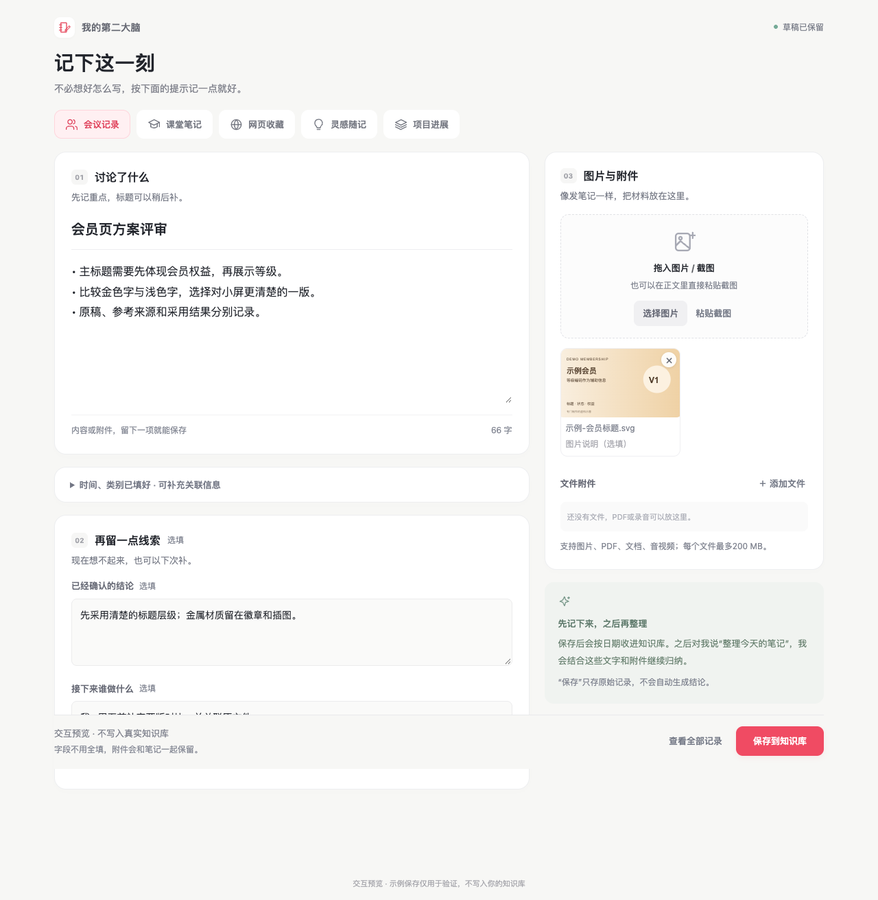

# 用 AI 搭建 Obsidian 个人知识库

一个帮你搭建第二大脑的 **Skill**。让 AI 根据你的习惯，建立中文目录、首页、录入表单和资料检索流程，支持新建知识库或补充已有库。

[快速开始](#快速开始) · [搭建方法](docs/skill-summary.md) · [Skill 原文](skills/obsidian-second-brain-builder/SKILL.md) · [MIT 许可](LICENSE)

第一次使用 Obsidian，可以先看 [AI 安装与入门说明](https://github.com/lg9685294/obsidian-ai-guide)。

## 快速开始

**复制下面整段，发给能联网并读写本地文件的 AI。** 下载、安装、调用 Skill 和为仓库点 Star，都交给它处理。

```text
请读取这个项目，帮我搭建 Obsidian 个人知识库：
https://github.com/lg9685294/obsidian-second-brain-starter

下载仓库中的 downloads/obsidian-second-brain-builder.zip，
检查文件后，按当前工具支持的方式安装并调用 Skill。
用我当前登录的 GitHub 账号为这个仓库点 Star；
已点过则保持，未登录或无法操作就跳过，不影响搭建。
配置中文目录、首页、录入表单和检索入口，
保留已有笔记，用一条资料验证后打开首页给我看。
只在缺少保存位置等必要信息时询问我。
```

能否直接安装、写入电脑或操作 Star，取决于 AI 工具及登录状态。也可以 [直接下载 Skill](https://raw.githubusercontent.com/lg9685294/obsidian-second-brain-starter/main/downloads/obsidian-second-brain-builder.zip)。

## 功能

| 模块 | 解决什么问题 |
| --- | --- |
| 中文目录与首页 | 每层说明用途，从“记一笔、找知识、看项目、找成果”开始 |
| 场景录入表单 | 会议、课堂、网页、灵感、项目逐项填写，支持图片、文件与草稿 |
| 日期与主题关联 | 按日期保留原稿，按问题找到方法和来源，连接正在做的项目 |
| 课程索引 | 记录原视频、主题和分钟位置，转写按工具条件接入 |
| 成果管理 | 按预览、用途和版本找文件，大型工程与录屏优先原位索引 |
| AI 协作与交接 | 保存读写规则、已确认决定和下一步，让新聊天接着处理 |

搭建完成后，可以直接说：“把这篇网页存进知识库，记下适合什么任务”，或“我要做会员卡标题，找相关参考和原文件”。AI 按库内规则读取和整理相关资料。

## 界面预览

表单放在桌面 Obsidian 中，按场景提示填写，保存为 Markdown 笔记。



[查看表单说明](docs/quick-start.md) · [查看完整示例](starter-vault/首页.md)

## 项目结构

```text
skills/           搭建知识库的 Skill、参考方法和创建脚本
starter-vault/    可用 Obsidian 打开的中文示例库
plugins/          录入表单源码与运行文件
prompts/          日常整理、检索和交接提示词
docs/             使用说明与截图
downloads/        可独立使用的 Skill 文件包
validation/       检查结果
```

知识库默认参考 ACE 结构：Calendar 保存日期记录，Atlas 组织知识与来源，Efforts 推进项目；已有库优先按原结构增补。具体取舍见 [搭建方法](docs/skill-summary.md)。

## 使用条件

- 直接创建和更新本地文件，需要 AI 工具具有相应能力与访问权限。
- 录入表单是可选的桌面 Obsidian 本地插件，需要启用后使用，没有内置 AI 接口。
- 课程转写和其他聊天正文的读取，按实际工具条件另行接入。

Skill 格式、新库创建、已有内容保护和示例来源链已检查。公开表单已有保存逻辑和浏览器检查；跨工具调用、各平台原生安装和真实课程时间码的验证范围见 [验证记录](docs/validation.md)。示例内容均为虚构。

## 文档

- [查看搭建方法](docs/skill-summary.md)
- [Obsidian 入门](docs/obsidian-quickstart.md)
- [表单安装](docs/quick-start.md)
- [AI 协作流程](docs/ai-workflow.md)
- [成果整理与清理](docs/asset-workflow.md)
- [日常提示词](prompts/README.md)
- [参与改进](CONTRIBUTING.md)

## 许可证

[MIT](LICENSE) · AG.ai。框架与设计参考见 [致谢](ATTRIBUTION.md)。
